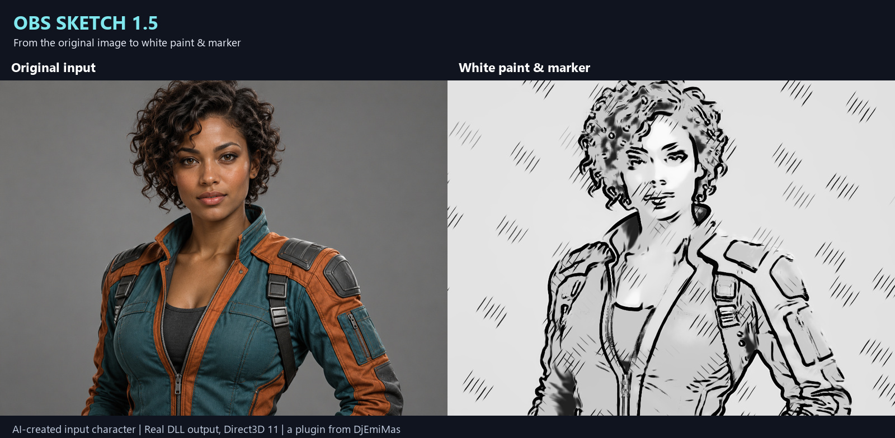
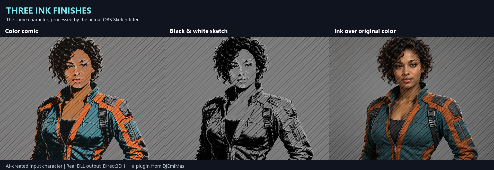

# OBS Sketch 1.5

A native Windows x64 effect filter for OBS Studio. Turn a camera, image, video or scene into comic, sketch and ink artwork while preserving source transparency.

**[Download the official 1.5 release](https://github.com/Emidj/obs-sketch/releases/tag/v1.5.0)** — Windows installer, portable plugin ZIP and source code.

## Features

- **Four finishes:** Color comic, Black & white sketch, Ink over original color, and White paint & marker.
- **Adjustable drawing:** line width, edge threshold, ink intensity, shading levels, hatching, texture smoothing and silhouette outlines.
- **Camera-motion tracking:** adapts the ink pattern to estimated translation, rotation and zoom, with manual re-anchoring.
- **Original-color reveal:** progressively restore the source colors while retaining ink and hatching.
- **Alpha preservation:** works after chroma key, background removal or an alpha mask, including soft edges. Silhouette ink stays inside the mask.
- **Independent instances:** apply different settings to different sources; the shader and branding are embedded in the plugin DLL.
- **Five languages:** English, Spanish, Italian, French and German, selected from the Windows display language. Other languages fall back to English.
- **Simple installation:** no Lua, Shaderfilter, Python or Internet connection is needed to use the filter.

## Examples

The input is an original AI-created fictional character. All filtered panels were rendered by the actual OBS Sketch 1.5 DLL through libobs / Direct3D 11, then arranged and labelled for comparison. The generated input is not a camera capture. See [example provenance](docs/EXAMPLES.md).

## Installation

1. Close OBS Studio.
2. Run **OBS-Sketch-1.5-Windows-x64-Setup.exe** and select **Install**. The installer is unsigned and installs to `C:\ProgramData\obs-studio\plugins\obs-sketch`.
3. Reopen OBS. Open your source's **Filters**, add an **Effect Filter**, and choose **OBS Sketch**.
4. Select a finish and adjust its controls. Place it after background removal or chroma key when using transparency.

For portable OBS, extract the Windows ZIP and copy `obs-sketch.dll` from `obs-sketch/bin/64bit` into your portable OBS `obs-plugins/64bit` folder. The shader is embedded; external data files are not needed to render. Use the same installer to uninstall the standard installation.

## Compatibility and limits

Validated with **OBS Studio 32.2.2, Windows x64, Direct3D 11 and NVIDIA GeForce RTX 5070**. Other OBS versions and GPUs need additional validation. HDR is passed through unchanged. Tracking is global motion estimation, not 3D reconstruction or independent object tracking; fast movement, perspective changes or low-detail images can cause sliding. Settings expressed in pixels depend on the source resolution.

This is a procedural real-time filter. It does not use generative AI while running and does not reproduce a painter's semantic decisions. The white-paint finish is an approximation, not an affiliated product or an exact reproduction of another artist's work.

Publication checks passed for the real GPU renderer, synthetic transparency fixtures, motion tests, 17 locale/fallback cases and installer translations. These local checks do not certify a long live-stream session or all hardware configurations. No new full OBS installation was performed during publication.

## Build and license

See [BUILD.md](BUILD.md) for the Windows build using Zig 0.15.2, OBS 32.2.2 headers, Python 3 and the Windows .NET Framework installer compiler. Source, shader, translations, tests and packaging scripts are included. Optional reference tests use local photos that are deliberately excluded from this repository.

Code: **GPL-2.0-or-later**, see [LICENSE](LICENSE) and [THIRD-PARTY-NOTICES.md](THIRD-PARTY-NOTICES.md). Original Spanish documentation is retained in [LEEME.md](LEEME.md).

a plugin from [DjEmiMas](https://discord.gg/dhcqZPDYh)
